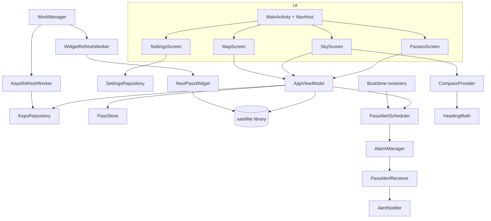

# Design: Satellite Companion Features

## Overview

The work is ordered so nothing is built twice:

1. **Data layer first**: move logic out of the Activity into small testable classes, replace serialized files with keps text and JSON, add scheduled keps refresh.
2. **Compose migration** with behaviour parity, adding strings resources, themes, adaptive layout and ViewModels as each screen moves.
3. **Features on the new UI**: pass alerts, compass.
4. **Widget**, then localisation clean-up.

The `uk.me.g4dpz.satellite` library is not modified except for one addition: `TLE.fromElements(...)`, a second way to construct a `TLE` from numeric orbital elements (see "Keps repository and refresh"). The prediction code is unchanged. The golden regression test runs after every task.

### Package layout (under `uk.me.g4dpz.HamSatDroid`)

| Package | Contents |
|---|---|
| `data` | `KepsSource`, `OrbitalElements`, `OmmJsonParser`, `TleTextParser`, `KepsDownloadPolicy`, `KepsRepository`, `PassStore`, `SettingsRepository`, `FileStore` (atomic writes) |
| `keps` | `KepsRefreshWorker`, `KepsScheduler` |
| `alerts` | `PassAlert`, `PassAlertStore`, `AlertTiming`, `PassAlertScheduler`, `AlertNotifier`, `PassAlertReceiver`, `AlertRescheduleReceiver` |
| `compass` | `HeadingMath`, `CompassProvider` |
| `domain` | `SkyGeometry`, `MapProjection`, `LocatorSync`, `PassSummary` (structured pass data for formatting) |
| `ui` | `MainActivity`, theme, navigation, screens (`PassesScreen`, `SkyScreen`, `MapScreen`, `SettingsScreen`, `AboutDialog`), charts (`SkyChart`, `WorldMap`), `AppViewModel`, `PassesViewModel` |
| `night` | `ThemeMode`, `NightPalette`, `NightModeController`, `AmbientLightProvider` |
| `doppler` | `FrequencyEntry`, `FrequencyStore`, `DopplerMath` |
| `overview` | `OverviewCalculator`, `OverviewViewModel`, `OverviewScreen` |
| `aim` | `PointingMath`, `AimState` |
| `speech` | `SpokenAnnouncer` |
| `widget` | `NextPassWidget`, `NextPassWidgetReceiver`, `WidgetUpdater`, `WidgetRefreshWorker` |



## Target device: Galaxy Tab A11

Design consequences of the target device (see requirements for the facts and sources):

- **Layout**: portrait is somewhere between about 533 and 800 dp wide depending on the density Samsung uses (213 dpi gives 601 dp, only just over the threshold). The two-pane threshold is 600 dp, not 840 dp, and the dashboard threshold is 960 dp. Both live in one place (`LayoutThresholds`), the real dp widths are measured on the device, and the thresholds are adjusted if the device falls on the wrong side. The layout must also look acceptable just below each threshold.
- **No gyroscope** (accelerometer, geomagnetic and light sensors only): the compass uses a fallback chain and stronger smoothing (below).
- **GPS availability is disputed by sources** for the Wi-Fi model (Samsung lists it, GSMArena says cellular only): the location UI is feature-gated at run time and the locator field is the primary path.
- **Often offline outdoors**: keps are refreshed while online; the About dialog shows their age. (A stale-keps warning is a possible follow-up, not in this spec.)
- **Samsung background restrictions** can defer alarms and WorkManager. A settings note and button explain how to exempt the app; alerts do not depend on the app being in memory.
- **Modest GPU (Mali-G57 MC2) and 4 GB RAM** in the base model: charts must not allocate per frame (already required), and the world map bitmap is decoded once at a size matching the canvas.
- **Multi-window/DeX**: all layouts respond to live size changes; no code assumes fullscreen.
- **Eight cores (2 x A76, 6 x A55), 90 Hz display, light sensor, stereo speakers, 8 GB RAM**: used for the parallel all-satellite overview, smooth compass rotation, automatic red night mode and spoken alerts.

## Dependencies and build changes

All versions are pinned to exact stable releases looked up at implementation time.

- Kotlin Compose compiler plugin `org.jetbrains.kotlin.plugin.compose` (same version as Kotlin, 2.0.21 or the Kotlin version in use).
- Compose BOM, `material3`, `ui-tooling-preview` (debug `ui-tooling`), `activity-compose`, `lifecycle-viewmodel-compose`, `lifecycle-runtime-compose`, `navigation-compose`, `material3-window-size-class` (and adaptive layout helpers if needed).
- `kotlinx-coroutines-android` (and `-test` for unit tests).
- `androidx.work:work-runtime-ktx`.
- `androidx.glance:glance-appwidget` and `glance-material3`.
- Test-only: `org.json:json` (the Android `org.json` stubs are unavailable on the JVM), `kotlinx-coroutines-test`.
- Manifest: remove `screenOrientation`; add `POST_NOTIFICATIONS`, `SCHEDULE_EXACT_ALARM`, `POST_PROMOTED_NOTIFICATIONS`, `RECEIVE_BOOT_COMPLETED`; add `android:localeConfig`, `enableOnBackInvokedCallback="true"`; declare receivers.
- Remove unused: `ASDActivity` base class and XML layouts once replaced.

Build warnings stay at zero; lint findings introduced by the migration are fixed or consciously suppressed.

## Storage (Requirement 9)

- **Keps**: `keps.json` in `filesDir` holding normalised orbital elements, one object per satellite, in our own schema (see `OrbitalElements` below), plus a small header (`source`, `fetchedAtMillis`, `schema`). It cannot be TLE text, because TLE lines cannot hold the 6-digit catalogue numbers now being issued.
- **Passes**: `passes.json` (`org.json`): array of `{start, end, tca, pole, aos, los, maxEl, catnum, satName}`. `PassStore` maps to/from `SatPassTime` via its public constructor. The pass list is recomputed on demand, so this file is only a convenience to show the last result after restart.
- **Alerts**: `alerts.json` via `PassAlertStore`, same helper.
- `FileStore.writeAtomic(name, bytes)` = temp file + atomic move (implemented and tested in task 1.3); `readOrNull` returns null on missing or unreadable content.
- First run of the new version deletes `elems.bin` and `prefs.bin`.
- No Room: see A2.

## Settings (Requirement 10)

`SettingsRepository` wraps `PreferenceManager`'s default file (`<package>_preferences`; read via `context.getSharedPreferences("${packageName}_preferences", MODE_PRIVATE)`, which is the same file the old default-shared-preferences API used) and exposes typed values as `StateFlow`s: `homeLat`, `homeLon`, `homeLocator` (stored as strings as before), `alertLeadMinutes` (default 5), `autoKepsRefresh` (default true), `kepsSource`, `compassEnabled` (default true).

`LocatorSync` holds the pure validation/sync rules lifted from `PrefHandling` (bounds ±90/±180, Maidenhead regex, lat/lon ↔ locator updates) so they can be unit tested. Formatting uses `Locale.ROOT`/`ENGLISH` for stored values.

`SettingsScreen` is a Compose form: text fields with numeric keyboard, validation messages, switches, a lead-time dropdown, keps source dropdown, "Use GPS", "Use network" buttons, and a language row opening the system per-app language screen.

Location actions are feature-gated: "Use GPS" is shown only when `PackageManager.FEATURE_LOCATION_GPS` is present , otherwise an explanatory line suggests the locator. If the network provider is disabled or returns no fix, a message says so. The locator field is placed first in the form. A "Background activity" card carries the Samsung/battery note and a button opening `Settings.ACTION_APPLICATION_DETAILS_SETTINGS`.

Location uses `LocationManager.getCurrentLocation(provider, cancellationSignal, executor, consumer)` (API 30), replacing the update-listener and progress dialog. A progress indicator and Cancel button are shown in Compose; cancel triggers the `CancellationSignal`.

## Compose architecture (Requirement 8)

### State

`AppViewModel` (Activity-scoped) owns, as `StateFlow`s:

- the satellite list (from `KepsRepository`) and `selectedCatnum`,
- the ground station (from settings),
- `passes: List<PassSummary>` and `selectedPass`,
- `PassHeader` (structured: satellite, lat/lon/locator, hours ahead, start time, or error/none-found state),
- `startTime: Instant?` (the "start time" override),
- loading flags for pass calculation and keps download.

`calculate(hoursAhead)` runs `PassPredictor` on `Dispatchers.Default` and produces `PassSummary` from `SatPassTime`. Replaces the static `HamSatDroid` companion fields and thread helpers. Selection is by catnum so keps updates do not lose it.

`PassSummary` is a plain data class (catnum, name, start, end, tca, pole, aosAz, losAz, maxEl); `SatPassTime` is converted at the boundary so the UI never calls the English `toString()` (Requirement 13.2).

### Screens

- **PassesScreen**: satellite dropdown, duration dropdown (Next pass only / 6 / 12 / 24 hours), start-time chip opening Material date and time pickers, Calculate button, header text, list of passes. Overflow menu: location (GPS / network / enter), download keps (six sources), ground view, help, about, settings.
- **SkyScreen**: header, pass details, `SkyChart`, current satellite details (refreshed every 5 s via `LaunchedEffect` + `repeatOnLifecycle`).
- **MapScreen**: `WorldMap` plus observer and satellite details (refreshed every second).
- **SettingsScreen** and **AboutDialog** as above.

Navigation: `NavHost` with routes `passes`, `sky`, `map`, `settings`. Swipe gestures from the old app (swipe right to go back, swipe left to open the map) are replaced by system back / predictive back and a menu action; the map is reachable from the menu and the sky screen.

### Charts

Charts are `Canvas` composables with geometry in pure functions:

- `SkyGeometry.azElToXY(az, el, radius)` (same maths as `azelToX/Y`), and `trackPoints(positions)`.
- `MapProjection.toXY(latDeg, lonDeg, w, h)` and `splitAtAntimeridian(points)` reproducing the old `0..360 → pixel` mapping and the "jump larger than 180 starts a new segment" rule (`footprint` and `track`).

Drawing state (`Path`, `Paint`, colours, precomputed track) is held in `remember`/`derivedStateOf` and rebuilt only when inputs change (new pass, new satellite), not every frame. Only the current satellite marker and footprint depend on the clock. This removes the `DrawAllocation` warnings.

Unit tests compare `SkyGeometry` and `MapProjection` outputs to the formulas in the existing View code for sample inputs before the Views are deleted.

### Theme and system integration

- `HamSatDroidTheme`: `dynamicLightColorScheme` / `dynamicDarkColorScheme` on API 31+, fixed Material 3 schemes below; sky/map colours come from the colour scheme with semantic fixed colours for track (yellow), footprint (red), N/E/S/W labels.
- `MainActivity` calls `enableEdgeToEdge()`; `Scaffold` handles insets. The manual `onApplyWindowInsetsListener` in `ASDActivity` is deleted with that class.
- Predictive back: `android:enableOnBackInvokedCallback="true"`; navigation-compose supports the animation; dialogs use `BackHandler` where needed.

## Adaptive layout (Requirement 12)

`calculateWindowSizeClass(activity)` gives the width class.

- **Two-pane** (≥ 600 dp, `LayoutThresholds.TWO_PANE_MIN_WIDTH_DP`): `Row` with `PassesScreen` on the left (about 40%) and a detail pane on the right showing `SkyScreen` for `selectedPass` (or a hint when none). The map stays a separate destination. On the Tab A11 this applies in both portrait and landscape, and in wide split-screen windows.
- **Single pane** (< 600 dp): navigation as above.

- **Dashboard** (≥ 960 dp, `LayoutThresholds.DASHBOARD_MIN_WIDTH_DP`): left pane is the pass list (about 30%); the remaining area shows `SkyChart` and `WorldMap`. `DashboardLayout.choose(widthDp, heightDp)` (pure, unit tested) returns `SideBySide` when the area can give each chart a useful size (both at least about 300 dp square, map kept 2:1) and `Stacked` otherwise (map above, sky below). Both charts use the same `AppViewModel` state and lifecycle-bound refresh as the single screens.

Layout choice is computed from the current window width, so Samsung split-screen, pop-up and DeX resizing re-lay out live. Very wide windows centre content with a maximum width for the list.

The manifest `screenOrientation` attributes are removed. Because state is in the Activity-scoped ViewModel and selections are by id, rotation/resizing keeps everything. The map keeps its 2:1 aspect ratio and is centred in the space available. Android 16 ignores orientation locks on large screens anyway, so this removes a latent bug.

## Keps repository and refresh (Requirements 5, 6)

### What Celestrak's documentation requires

From Celestrak's "A New Way to Obtain GP Data" page (the design follows it):

- Queries take the form `https://celestrak.org/NORAD/elements/gp.php?GROUP=<name>&FORMAT=<format>`; the query name must be upper case; formats include `TLE`, `JSON`, `CSV`, `XML`, `KVN`. If `FORMAT` is omitted it now defaults to CSV, so the format is always given explicitly.
- The old static `.txt` files were removed (all gone by 2024-12-24), which is why the original app's Celestrak downloads return 404.
- On 2026-07-11 the 5-digit catalogue numbers ran out. Objects numbered 100000 and above are not available as TLE. The JSON and CSV formats have no such limit. At the time of writing the amateur group includes AO-129 and AO-130 with 6-digit numbers.
- Data refreshes every 2 hours. A repeat download of the same group before it updates is refused with HTTP 403 and a message; more than 50 errors of 301, 403 or 404 within 2 hours puts the client's IP address in the firewall. Errors must therefore be checked and **not** retried blindly. Using the `.com` host causes redirects (HTTP 301) and must be avoided.
- Only the data needed should be downloaded. The app downloads only the one selected group, never "active" or other large sets.
- JSON field names are the OMM keywords: `OBJECT_NAME`, `OBJECT_ID`, `EPOCH` (ISO 8601, UTC), `MEAN_MOTION`, `ECCENTRICITY`, `INCLINATION`, `RA_OF_ASC_NODE`, `ARG_OF_PERICENTER`, `MEAN_ANOMALY`, `EPHEMERIS_TYPE`, `CLASSIFICATION_TYPE`, `NORAD_CAT_ID`, `ELEMENT_SET_NO`, `REV_AT_EPOCH`, `BSTAR`, `MEAN_MOTION_DOT`, `MEAN_MOTION_DDOT`. Checked against a live download: for AO-7 every value matches the same satellite's TLE (including `MEAN_MOTION_DOT` = TLE first-derivative field and `BSTAR` = the decoded TLE B* value).

### Orbital elements

(Implemented: `OrbitalElements` lives in the library package `uk.me.g4dpz.satellite`, because it is the library's input type, and holds the epoch as `epochYear` plus `epochDay` rather than milliseconds so that converting a TLE to elements and back is exact.)

```kotlin
data class OrbitalElements(
    val name: String, val catnum: Int,            // catnum fits in Int (up to 9 digits)
    val epochUtcMillis: Long,                     // exact instant; TLE year/day derived from it
    val meanMotion: Double, val eccentricity: Double, val inclination: Double,
    val raan: Double, val argPerigee: Double, val meanAnomaly: Double,
    val bstar: Double, val meanMotionDot: Double, val meanMotionDdot: Double,
    val elementSetNo: Int, val revAtEpoch: Int,
)
```

- `OmmJsonParser.parse(text): List<OrbitalElements>` reads the Celestrak JSON array with `org.json`. A record missing a required field, or with a non-numeric value, is skipped and counted; a response that is not a JSON array (for example the text error message Celestrak can return with HTTP 200) throws `InvalidKepsException`.
- `TleTextParser.parse(text): List<OrbitalElements>` uses the existing `TLE.importSat` and converts each `TLE` with `OrbitalElements.from(tle)`.
- `TLE.fromElements(OrbitalElements): TLE` is a **small addition to the library**: a second way to construct `TLE` that fills the same fields as the text constructor (`catnum`, `name`, `setnum`, `year` (two digits), `refepoch` (day of year with fraction, from the epoch instant), `incl`, `raan`, `eccn`, `argper`, `meanan`, `meanmo`, `drag` (= `MEAN_MOTION_DOT`), `nddot6` (= `MEAN_MOTION_DDOT`), `bstar`, `orbitnum`) and then runs the existing `preProcessTLESet`. The text constructor and all prediction code are unchanged; the golden test stays as it is, and a new test proves equivalence (below).
- Epoch handling: the TLE class uses a two-digit year and valid range 1957 to 2056, which is acceptable for current data; elements with epochs outside that range are skipped.

### Download policy (pure, unit tested)

`KepsDownloadPolicy`:

- `canDownload(source, lastFetchedMillis, now)` is false inside `KepsSource.MIN_DOWNLOAD_INTERVAL_MILLIS` (2 hours) of the last successful or attempted download for that source.
- `classify(httpStatus, bodyPrefix)` returns `Success`, `Transient` (IOException, timeout, 5xx), or `Permanent` (301, 403, 404, 429, other 4xx, or an HTTP 200 whose body is not valid data). Only `Transient` may be retried, with a bounded number of attempts (3), after which the run is a failure until the next period.
- A `Permanent` result stores the reason and time (shown in About) and is never retried within the 2-hour window.

### KepsRepository

`KepsRepository(context)`:

- `loadStored(): List<TLE>?` reads `keps.json` and builds `TLE` objects with `TLE.fromElements`; null if missing or corrupt,
- `loadBundled(): List<TLE>` reads `R.raw.nasabare` through `TleTextParser`,
- `download(source): String` with `HttpURLConnection`: https only, no redirects followed, connect/read timeouts (about 15 s / 30 s), response size cap (1 MB), `User-Agent: AmsatDroidFree/<versionName> (+contact)`, returns the body or throws a classified error,
- `parse(source, text)` chooses `OmmJsonParser` or `TleTextParser` by `source.format` and rejects an empty result,
- `store(elements, source, now)` writes `keps.json` atomically; `recordFailure(source, reason, now)`,
- `refresh(source)` = policy check, download, parse, store, record; returns `Updated(count)`, `UpToDate(fetchedAt)` (inside the 2-hour window), or `Failed(kind, reason)`,
- on first run with nothing stored: convert the bundled keps and store them silently.

### Worker and scheduling

`KepsRefreshWorker` calls `refresh(sourceFromSettings)`. `Updated` and `UpToDate` return `Result.success()` (and `Updated` triggers `WidgetUpdater.updateAll`). A `Transient` failure returns `Result.retry()` while `runAttemptCount < 3`, then `Result.failure()`. A `Permanent` failure returns `Result.failure()` immediately; the periodic work still runs next period, so there is no retry loop that could hammer the server. `KepsScheduler.apply(enabled)` enqueues unique periodic work (24 h, flex 6 h, `NetworkType.CONNECTED`, `ExistingPeriodicWorkPolicy.UPDATE`) or cancels it; it is called when the app starts and when the setting changes.

### Foreground refresh

`AppViewModel` observes the `keps.json` modified time (checked on `ON_START`) and reloads and rebinds when it changed, keeping `selectedCatnum`. Manual downloads go through `refresh`, so a second tap inside 2 hours shows "Already up to date (fetched at …)". The SD-card lookup, its dialogs and `MENU_LOAD_ELEM` are deleted. The About dialog shows source, fetch time, and the last failure if any, or "bundled".

### Default source

`KepsSource.DEFAULT` is `AMATEUR_CELESTRAK` (JSON), decided in A14/D5. A fresh install starts with the bundled keps and replaces them with this source on the first refresh. Existing installs that never chose a source also get this default; a source the user chose explicitly is kept. The repository handles both formats, so the AMSAT option keeps working.

### Element age warning (Requirement 5.15)

`domain/ElementAge` (pure, unit tested) turns a TLE epoch into UTC milliseconds (two-digit years 57 to 99 are 1957 to 1999, 00 to 56 are 2000 to 2056; day 1.0 is midnight on 1 January) and reports the age in whole days, or null when it is not over `STALE_AFTER_DAYS` (30). `SatelliteItem` carries each satellite's `epochMillis`, filled from the TLE when the keps are applied. The passes pane measures from the chosen start time, or now, and shows the warning (plurals resource, error colour) above the pass header. It warns only; it does not block predictions.

The case that prompted this: a fresh install whose first download failed kept the bundled keps, whose ISS elements date from January 2010, and predicted impossible passes and a meaningless ground track with no sign anything was wrong.

## Pass alerts (Requirements 1 to 3)

### Data and storage

```kotlin
data class PassAlert(
    val catnum: Int, val satName: String,
    val aosMillis: Long, val losMillis: Long,
    val maxElDeg: Double, val aosAz: Int, val losAz: Int,
) { val id: Int get() = (catnum.toLong() * 31 + aosMillis / 1000).hashCode() }
```

`PassAlertStore` keeps `alerts.json` via `FileStore`; `all()`, `add()`, `remove(id)`, `contains(id)`, `pruneEnded(now)`.

### Timing (pure, unit tested)

`AlertTiming(alert, leadMinutes, now)` → trigger times `lead = aos - lead`, `aos`, `los`; past triggers are dropped, but a pass in progress still yields the correct state immediately.

### Scheduling

`PassAlertScheduler.schedule(alert)` uses three `PendingIntent`s (`FLAG_IMMUTABLE | FLAG_UPDATE_CURRENT`) to `PassAlertReceiver` with actions `ALERT_LEAD`, `ALERT_AOS`, `ALERT_LOS`, request codes derived from the alert id. It uses `setExactAndAllowWhileIdle` when `canScheduleExactAlarms()`, else `setAndAllowWhileIdle`. `cancel(alert)` cancels all three. `rescheduleAll()` prunes ended alerts and re-registers the rest. Intents carry only the alert id; the receiver loads the alert from the store, so a cleared alert silently does nothing.

### Notification

`AlertNotifier` owns channel `pass_alerts` (importance DEFAULT, not MIN) and one notification id per alert.

- LEAD: title "`<sat>` rises soon", text with AOS azimuth and max elevation, `setWhen(aos)`, `setUsesChronometer(true)`, `setChronometerCountDown(true)`, ongoing, only-alert-once, tap opens the app.
- AOS: same id, title "`<sat>` is up", `setWhen(los)` countdown.
- LOS: cancel.

All text from string resources with placeholders. The system draws the countdown, so no foreground service is needed.

Live Update promotion on API 36 (behind `Build.VERSION.SDK_INT >= 36`): set `Notification.EXTRA_REQUEST_PROMOTED_ONGOING`; the notification is ongoing, has a title, no custom RemoteViews, is not colorized, and the channel is above IMPORTANCE_MIN. If `NotificationManager.canPostPromotedNotifications()` is false it posts as a normal ongoing notification. On API 30–35 the same notification is posted without the promotion request. Late delivery (Doze, past AOS) is handled by comparing `now` with AOS/LOS.

`AlertRescheduleReceiver` handles `BOOT_COMPLETED`, `MY_PACKAGE_REPLACED`, `TIME_SET`, `TIMEZONE_CHANGED` and `ACTION_SCHEDULE_EXACT_ALARM_PERMISSION_STATE_CHANGED`, doing nothing for any other action.

### Permissions flow and UI

On the first "set alert": request `POST_NOTIFICATIONS` (API ≥ 33) with the Compose permission launcher; store and schedule only when granted. If exact alarms are not permitted and the user has not been asked, show a dialog offering `ACTION_REQUEST_SCHEDULE_EXACT_ALARM`; the answer is remembered. In `PassesScreen`, pass rows use `combinedClickable(onClick = open sky, onLongClick = toggle alert)` and show a bell icon when an alert exists. The lead time setting is in `SettingsScreen`; changing it calls `rescheduleAll()`.

## Compass (Requirement 4)

`HeadingMath` (pure, unit tested): `smooth(prev, new, alpha)` using the shortest signed difference, `trueHeading(magnetic, declination)`.

`CompassProvider` chooses a source in order (the Tab A11 SM-X130 lists accelerometer and geomagnetic sensors but no gyroscope, so the first option may be absent or low quality):

1. `TYPE_ROTATION_VECTOR` (`getRotationMatrixFromVector`),
2. `TYPE_GEOMAGNETIC_ROTATION_VECTOR` (same conversion; accelerometer-free, lower accuracy),
3. `TYPE_ACCELEROMETER` + `TYPE_MAGNETIC_FIELD` with a low-pass filter and `SensorManager.getRotationMatrix`.

It then applies `remapCoordinateSystem` for the display rotation (`display.rotation`, API 30). Orientation handling: when the device is closer to flat (gravity mostly along Z) the heading is the azimuth of the device's top edge; when held upright it is the azimuth of the direction the back of the device faces (remap X/Z). The switch uses a threshold with hysteresis so it does not flip near 45°. `GeomagneticField` declination from the ground station is added, the result smoothed (stronger alpha for sources 2 and 3, which are noisier), and emitted as `Orientation(rotationMatrix, headingDegrees, accuracy, sourceName)` on a `Flow`. The matrix is kept so the aiming aid can derive elevation without a second sensor registration. Smoothing is applied to azimuth (circular) and to the elevation value, not to the matrix itself. It is collected in `SkyScreen` using `repeatOnLifecycle(STARTED)`, so the sensor registers only while the screen is visible. No usable source → `isAvailable == false`, chart stays north-up and the toggle is hidden. The source in use is exposed for diagnostics (shown in a small debug line in debug builds).

`SkyChart(rotationDeg)` applies `rotate(-heading)` in `DrawScope`; satellite maths are untouched. A small banner shows a calibration hint while accuracy is low. The toggle (an icon button in the top bar) writes `compassEnabled`, default true.

## Widget (Requirement 11)

`NextPassWidget : GlanceAppWidget` with `NextPassWidgetReceiver : GlanceAppWidgetReceiver`. `WidgetUpdater.compute(context)` loads the stored keps, the last selected satellite (persisted in settings as `selectedCatnum`) and the ground station, then runs `PassPredictor.nextSatPass(now)` and returns a `WidgetState` (`NoLocation`, `NoSatellite`, `Ready(pass)`, `Error`). The Glance content shows name, AOS clock time and "in n min", max elevation and azimuths, styled with Glance Material 3 (dynamic colour where available). Tapping launches `MainActivity`.

Updates: `WidgetUpdater.updateAll` is called after keps refresh, after satellite/location changes, and by `WidgetRefreshWorker` (unique periodic work, ~30 min) which is enqueued in `onEnabled` and cancelled in `onDisabled` of the receiver. The widget shows absolute times so slight staleness is harmless. The provider XML declares `resizeMode="horizontal|vertical"`, a small minimum size and a larger target size; the Glance content uses `SizeMode.Responsive` with a compact layout (name and AOS time) and a larger one (adds elevation, azimuths and LOS) so it suits both phone and tablet home screens.

## Localisation (Requirement 13)

- All strings move to `res/values/strings.xml` with `%1$s` style placeholders and plurals where needed; no string concatenation in UI code.
- `PassSummary` formatting happens in composables using `stringResource` and `DateFormat`/`java.time` formatters in the user's locale; stored values use fixed formats.
- `res/xml/locales_config.xml` declares supported languages (English initially) referenced with `android:localeConfig`; Settings has a "Language" row that opens `Settings.ACTION_APP_LOCALE_SETTINGS` (API 33+; hidden below).
- Notification and widget text use the same resources.
- A string audit (grep for literals in Kotlin UI code and `HardcodedText` lint) is part of wrap-up.

## Night mode (Requirement 14)

`ThemeMode { SYSTEM, LIGHT, DARK, RED_NIGHT }` is stored in settings (`themeMode`, default SYSTEM) with `autoRedNight` (default false).

`NightPalette` is a Material 3 `ColorScheme` built only from red/black shades (for example background near black, surfaces dark red, primary a bright red, text pale red). It deliberately avoids hues other than red. `HamSatDroidTheme(mode)` picks light, dark, dynamic or the night palette. Semantic chart colours come from a `ChartColors` object that has a red-night variant where track, footprint, labels and the satellite marker are told apart by luminance, line style (solid, dashed, thick) and text labels, not hue. Dialogs, menus, pickers and the notification-free parts of the UI all take the theme, so nothing white appears. The system bars use light-on-dark icons.

`NightModeController` is a pure state machine: inputs are lux samples with timestamps, outputs `isNight`. It switches on when lux is below `ENTER_LUX` (about 5) continuously for `ENTER_SECONDS` (about 5) and off when above `EXIT_LUX` (about 20) for `EXIT_SECONDS` (about 3). Thresholds are constants, tuned on the device. `AmbientLightProvider` exposes a `Flow<Float>` over `Sensor.TYPE_LIGHT`, collected with `repeatOnLifecycle(STARTED)` only while `autoRedNight` is on and a light sensor exists. The effective theme is `if (auto && isNight) RED_NIGHT else themeMode`; it is read at the top of the composition so switching recomposes in place without recreating the Activity. The window brightness is not touched.

## All-satellite overview (Requirement 16)

`OverviewCalculator.calculate(sats, station, start, hours, minEl)` returns a `Flow<OverviewItem>`:

- one coroutine per satellite on `Dispatchers.Default.limitedParallelism(cores)`,
- **each task builds its own `GroundStationPosition` copy and its own `PassPredictor`**, because `AbstractSatellite.calculateUserPosVel` writes `theta` into the ground station, so sharing one object across threads would be a data race,
- each task computes the current `SatPos` (for "up now") and `PassPredictor.getPasses(start, hours, true)` (wind back so an in-progress pass is found),
- `SatNotFoundException` (never visible) and `InvalidTleException` are caught per satellite and skipped,
- results are emitted as each satellite finishes and merged into a sorted list by the ViewModel (`StateFlow<List<OverviewRow>>`), so rows appear progressively,
- cancelling the collecting scope cancels all tasks.

`OverviewViewModel` holds window hours (6/12/24, default 12), minimum max-elevation (0/10/20/30, default 0), a cached result keyed by (keps timestamp, station, start hour, hours), and a progress count. `OverviewScreen` has a "Now" section (az/el, time to LOS) and an "Upcoming" list; a progress indicator while computing; tap → select satellite and pass → sky screen; long-press → alert toggle (same alert path as Requirement 1). Elapsed time is logged and shown in a debug line to record the real figure for Requirement 16.10. A unit test runs the calculator over the bundled keps and checks parallel results equal sequential results for the same inputs (guarding the thread-safety point above).

## Aiming aid (Requirement 17)

`PointingMath` (pure, unit tested) takes a world-from-device rotation matrix and an axis (top edge = device +Y, back of device = device −Z), plus the magnetic declination, and returns `(azimuthDeg, elevationDeg)` of that axis in true-north, up-positive coordinates. Edge cases: a vertical axis gives an undefined azimuth, so the last value is kept and flagged; azimuth wraps through 0/360.

`AimState.compute(pointing, target)` returns `deltaAz` (shortest signed difference, -180..180), `deltaEl`, and a status: `OnTarget` when both are within 5°, `Aiming`, or `BelowHorizon` (with time and azimuth of next rise taken from the pass data). It also formats nothing; wording is done in the UI from string resources, for example "turn right/left N°" and "raise/lower N°".

The sky screen gets an Aim toggle (off by default). In Aim mode it shows the two bearings, the two deltas as large text with arrows, the sensor accuracy and a short magnet/metal warning, and an on-target indicator that uses an icon and text plus colour. It uses the same `CompassProvider` flow and lifecycle collection as the compass, so sensors unregister when the screen is not visible. A setting `pointingAxis` (TOP_EDGE default, BACK) selects the axis.

## Doppler (Requirement 15)

`FrequencyEntry(catnum, label, downlinkHz: Long, uplinkHz: Long?)` stored in `frequencies.json` by `FrequencyStore` (atomic JSON). The sky screen's detail card has a drop-down of entries for the selected satellite, an add/edit dialog (label, downlink, uplink in kHz or MHz with fixed-locale parsing) and delete.

`DopplerMath` (pure):

```
downlinkHz(nominal, rangeRateKmS) = nominal * (c - rangeRateKmS * 1000) / c
uplinkHz(nominal, rangeRateKmS)   = nominal * (c + rangeRateKmS * 1000) / c
```

with `c = 2.99792458E8`, exactly the library's formulas. The range rate comes from the `SatPos` already computed for the sky screen each second, so no extra prediction work is done. A unit test checks `DopplerMath` equals `PassPredictor.getDownlinkFreq/getUplinkFreq` for a golden satellite and time. The shift shown is `corrected - nominal`. The sky screen's detail refresh becomes 1 s while an entry is displayed (5 s otherwise). Values are shown to 1 Hz using a locale `NumberFormat`. Below the horizon the same numbers are shown with a "not currently visible" note.

## Keep screen on (Requirement 18)

A small composable effect, `KeepScreenOn(enabled)`, sets `view.keepScreenOn = true` in a `DisposableEffect` and clears it on dispose, applied inside `SkyScreen` and `MapScreen` (and the dashboard's chart area). The setting `keepScreenOn` defaults to true.

## Spoken alerts (Requirement 19)

`SpokenAnnouncer.speak(context, text, onDone)` creates a `TextToSpeech`, waits for `onInit`, sets the app locale, requests transient audio focus with `AudioAttributes(USAGE_ASSISTANCE_NAVIGATION_GUIDANCE, CONTENT_TYPE_SPEECH)` and `AUDIOFOCUS_GAIN_TRANSIENT_MAY_DUCK`, speaks with `QUEUE_FLUSH`, then abandons focus and calls `shutdown()` on completion or after a timeout (about 8 s). `PassAlertReceiver` uses `goAsync()` so the receiver stays alive for the announcement and calls `finish()` in `onDone`; this needs no foreground service and no permission. If initialisation fails or times out the announcement is skipped silently and the notification is unaffected. Spoken strings are separate resources (`spoken_pass_soon`, `spoken_pass_start`, `spoken_pass_end`) written for speech, with numbers passed as placeholders and plurals where needed. It is best effort: the system limits how long a receiver can run, and manufacturer battery rules may delay or kill it.

## Testing strategy

JVM unit tests (JUnit, same setup as the golden test):

- `AlertTimingTest`, `PassAlertStoreTest`, `HeadingMathTest`, `LocatorSyncTest`.
- `OmmJsonParserTest` (a recorded sample of the Celestrak amateur JSON including 6-digit catalogue numbers, missing fields skipped, non-array rejected, Celestrak error text rejected), `TleTextParserTest`.
- `OrbitalElementsEquivalenceTest`: every satellite in the bundled keps, read as TLE text, converted to `OrbitalElements`, stored to JSON and read back, then rebuilt with `TLE.fromElements`, has the same values for every field the prediction code reads, and gives the same predicted position as the original `TLE` to within 1e-9; the 6-digit catalogue number case is covered with a synthetic record.
- `KepsDownloadPolicyTest` (2-hour window boundaries, classification of 200/301/403/404/429/500/IOException/200-with-error-text, bounded retries).
- `KepsRepositoryTest` (empty input rejected, failed store keeps old file, corrupt file falls back to bundled, atomic write, inside-window request returns `UpToDate` without a network call, uses an injected fake downloader), `PassStoreTest` (JSON round trip).
- `SkyGeometryTest`, `MapProjectionTest` (compared with the legacy formulas, antimeridian splitting).
- `NightModeControllerTest` (hysteresis, timing, no flicker), `DashboardLayoutTest` (side by side versus stacked at representative sizes including the Tab A11 landscape and split-screen), `DopplerMathTest` (agrees with `PassPredictor`, sign conventions, large and zero range rate), `FrequencyStoreTest` (JSON round trip, corrupt file), `PointingMathTest` (known matrices: flat facing north gives az 0 el 0 for the top edge; upright facing east; vertical axis; declination), `AimStateTest` (wrap-around, on-target, below horizon), `OverviewCalculatorTest` (parallel equals sequential, skipping never-visible satellites, cancellation).
- `AppViewModelTest` with `kotlinx-coroutines-test`: calculate passes, selection retained across keps reload.

Manual checks are in `manual-test-checklist.md`. The golden regression test runs after every task.

## Risks

- **Compose migration is large and cannot be fully verified without a device.** Mitigation: parity first, geometry in tested pure functions, screen-by-screen tasks that each leave the app working, and a device checklist.
- **Live Update behaviour** differs by device; the standard notification is the primary path and promotion is an enhancement.
- **Exact alarms** may be unavailable; inexact timing can be minutes late. The countdown uses absolute AOS/LOS times so it is correct even if the alert is late.
- **Magnetic interference** can degrade heading; the hint and the off switch address this.
- **Pass staleness**: a stored alert or widget pass uses the pass as computed at that time; keps changes may shift it by seconds to minutes.
- **Samsung battery management** may defer alarms and WorkManager when the app is "sleeping" or auto-optimised. Mitigation: the settings note and shortcut, exact alarm opt-in, absolute-time countdowns, and a device test with the screen off overnight.
- **No gyroscope** gives a noisier heading; mitigated by the fallback chain, stronger smoothing, the calibration hint and the off switch. Real accuracy is only known from device testing.
- **Android version of the target device** may be 15 (no Live Updates) or 16 (Samsung offers the update); both paths are supported and tested. On Android 16 One UI 8 may present Live Updates differently from stock Android; this is checked on the device.
- **Overview cost**: about 150 satellites over 24 hours is the heaviest calculation in the app. It runs in parallel and streams results, and the real duration on the Helio G99 is measured and recorded. If it is too slow, the default window can be shortened or the calculation limited to satellites chosen by the user.
- **Shared `GroundStationPosition`** is mutated by the prediction code; every parallel task must use its own copy (covered by a test).
- **Aiming accuracy**: without a gyroscope and near radio equipment, magnets or metal, the heading can be off by many degrees; the display shows accuracy and a warning, and the feature is advisory only.
- **Spoken alerts** depend on a TTS engine being installed and on the receiver being allowed to run for a few seconds; they are best effort.
- **Red night mode contrast** depends on the TFT panel; thresholds and colours are tuned on the device.
- **User-entered frequencies** may be wrong; the app does not validate them against any list.
- **Celestrak policy**: repeated or erroring requests can get the user's IP blocked. Mitigated by the 2-hour minimum, no retry on 301/403/404/429, one selected source only, the `.org` host, and a descriptive User-Agent. The policy is a single tested class.
- **Source differences**: AMSAT and Celestrak list different satellites and only Celestrak JSON carries 6-digit numbers; the default is a user decision (A14).
- **Unverified format details**: JSON field semantics were checked against one satellite's TLE; the equivalence test and the pass comparison on the device cover the rest.
- **Dependencies grow** (Compose, WorkManager, Glance): APK size increases by several MB. Accepted.
- **Discarding legacy serialized data** means a one-time reset of stored keps and passes; mitigated by bundled keps and an immediate refresh.
