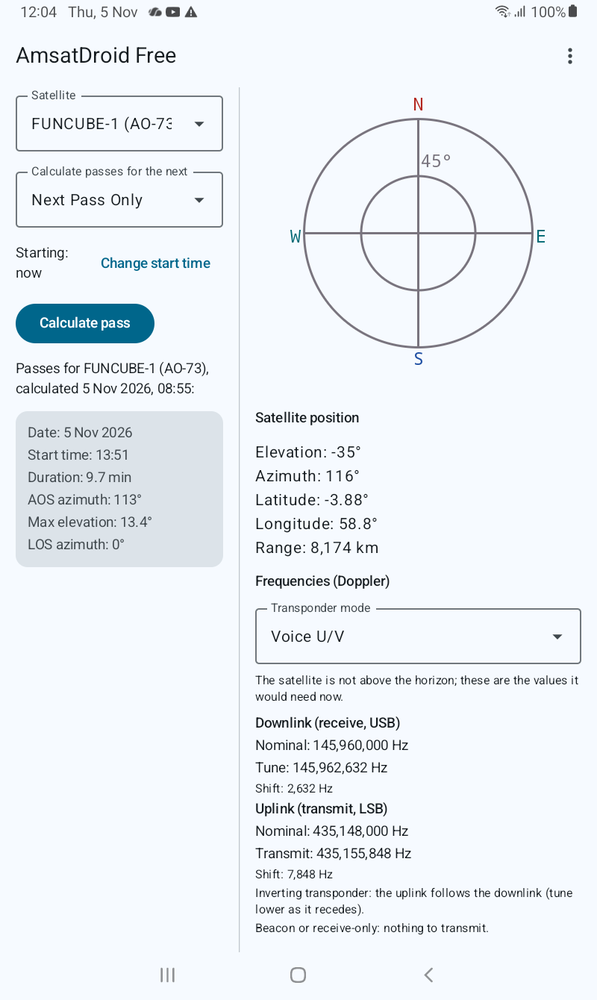

# AmsatDroid Free

Amateur radio satellite pass calculator and companion for Android.

AmsatDroid Free (package `uk.me.g4dpz.HamSatDroid`) predicts amateur satellite
passes for your location, shows a live sky view and ground track, and helps you
work a pass: Doppler-corrected frequencies, pass alerts, a compass-oriented sky
chart, an aiming aid, an all-satellite overview, and a home-screen widget.

The app has been rebuilt as a modern Kotlin / Jetpack Compose application. The
orbit-prediction core is the long-standing `uk.me.g4dpz.satellite` SGP4/SDP4
library, kept under a golden regression test so predictions do not drift.

<p align="center">
  
</p>

*Main screen on a Galaxy Tab A7 Lite (two-pane layout): pass prediction and the
satellite chooser beside the sky chart, live satellite position, and the
Doppler-corrected transponder frequencies drawn from the OscarWatch database.*

## Features

- **Pass prediction** for your location, with a selectable time window and start time.
- **Sky view** of the selected pass, with the live satellite position.
- **Ground-track map** with footprint, updated each second.
- **Doppler-corrected frequencies** from the OscarWatch transponder database
  (see [Satellite frequencies](#satellite-frequencies)): pick a transponder
  mode and see the downlink to tune and the uplink to transmit, corrected in
  real time, including inverting (REV) transponders and FM CTCSS tones.
- **Pass alerts** with a system countdown notification, optional spoken
  announcements, and (on Android 16+) Live Update promotion where available.
- **Compass-oriented sky chart** and an **aiming aid** that tells you which way
  to turn and tilt the device, using the rotation-vector / geomagnetic sensors
  (works without a gyroscope).
- **All-satellite overview**: what is up now and what is coming across every
  satellite in the current elements.
- **Scheduled keps refresh** that keeps orbital elements current in the
  background, from Celestrak (JSON) or AMSAT (TLE).
- **Home-screen widget** showing the next pass for the last selected satellite.
- **Adaptive layouts** (phone, two-pane tablet, landscape dashboard), a
  **red night mode**, per-app **language** support, and **keep-screen-on**
  while tracking.

## Requirements

| | |
|---|---|
| Minimum Android | 11 (API 30) |
| Target / compile SDK | Android 16 (API 36) |
| Language | Kotlin, Jetpack Compose (Material 3) |
| Build | Gradle (wrapper 8.13), AGP 8.13, JDK 17 |

Primary development/test device: **Samsung Galaxy Tab A7 Lite, SM-T225**
(1340 × 800, no gyroscope). The app also runs on any Android 11+ phone or tablet.

## Building

Requires JDK 17 and the Android SDK (set `sdk.dir` in `local.properties`, or
`ANDROID_HOME`).

```bash
# Build the debug APK
./gradlew :app:assembleDebug

# Run the JVM unit tests (includes the golden orbit regression test)
./gradlew :app:testDebugUnitTest

# Android lint
./gradlew :app:lintDebug

# Install on a connected device/emulator
./gradlew :app:installDebug
```

The same gate — assemble, unit tests and lint — runs in CI on every push and
pull request (`.github/workflows/ci.yml`).

## Satellite frequencies — the OscarWatch transponder database

> **AmsatDroid Free uses the OscarWatch transponder database maintained by
> Peter Goodhall (MM9SQL).** The app would not have live, maintained transponder
> frequencies without it — our thanks to Peter and the OscarWatch project.

Transponder characteristics — downlink and uplink frequencies, modulation modes
(USB/LSB/CW/FM…), Doppler direction (normal or REV for inverting transponders)
and FM uplink CTCSS tones — all come from the OscarWatch transponder database
(`satellite_database.json`), rather than from anything the user types in.

How the app uses it:

- **Bundled fallback.** A copy ships inside the app so frequencies are available
  offline and on first run.
- **Live sync from Peter's API.** The app fetches the published database from
  **<https://tle.oscarwatch.org/satellite_database.json>** on the same
  background schedule as the orbital elements, with the same safeguards
  (https only, no redirects, a response size cap, timeouts, a User-Agent that
  names the app, and a shared minimum interval between fetches). A valid sync
  replaces the local copy wholesale; any failure keeps the copy already in use.
- **Read-only.** Matched to satellites by NORAD id. There is no in-app frequency
  editor — the database is the single source of truth, kept current from Peter's
  server. This mirrors OscarWatch's own `user → bundled → remote` model.

The same database powers Peter's cross-platform
[OscarWatch-Tracker](https://github.com/magicbug/OscarWatch-Tracker) desktop app,
so the two stay in step.

Orbital elements (keps) are a separate data source, downloaded from Celestrak or
AMSAT.

## Project layout

```
app/src/main/java/uk/me/g4dpz/HamSatDroid/   app code (UI, data, domain, alerts, widget)
app/src/main/java/uk/me/g4dpz/satellite/      SGP4/SDP4 orbit-prediction library
app/src/test/                                 JVM unit tests and recorded test data
app/src/main/res/raw/                          bundled keps and transponder database
.kiro/specs/satellite-companion-features/      requirements, design and task plan
```

## Credits

- Orbit prediction: the `uk.me.g4dpz.satellite` SGP4/SDP4 library.
- Transponder frequencies: the **OscarWatch** database by Peter Goodhall
  (MM9SQL) — <https://github.com/magicbug/OscarWatch-Tracker>,
  synced from <https://tle.oscarwatch.org/>.
- Orbital elements: [Celestrak](https://celestrak.org/) and
  [AMSAT](https://www.amsat.org/).

## Disclaimer

This software is provided "as is" with no explicit or implied warranties in
respect of any properties, including, but not limited to, correctness and
fitness for purpose.

## Licence

AmsatDroid Free is licensed under the **GNU General Public License v3.0 or
later** (`GPL-3.0-or-later`). See [LICENSE](LICENSE) for the full text; source
files carry an `SPDX-License-Identifier: GPL-3.0-or-later` header.

The orbit-prediction core (`uk.me.g4dpz.satellite`, the **predict4java** library,
Copyright © 2004–2010 David A. B. Johnson, G4DPZ) is **GPL-2.0-or-later**; the
"or later" clause is what allows the combined work to be distributed under
GPL-3.0. Those files keep their original predict4java licence header.

The bundled OscarWatch transponder database is a separate work under its own
MIT licence (see [Satellite frequencies](#satellite-frequencies) and
[Credits](#credits)); its copyright notice is retained.
